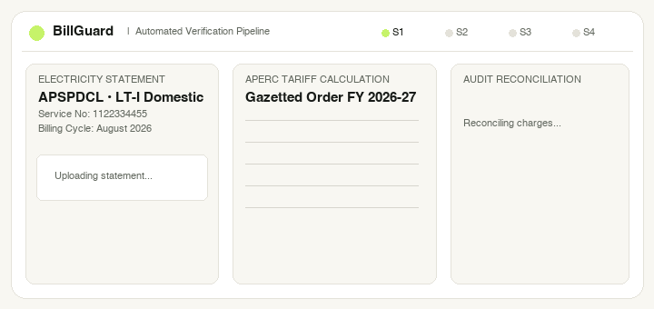
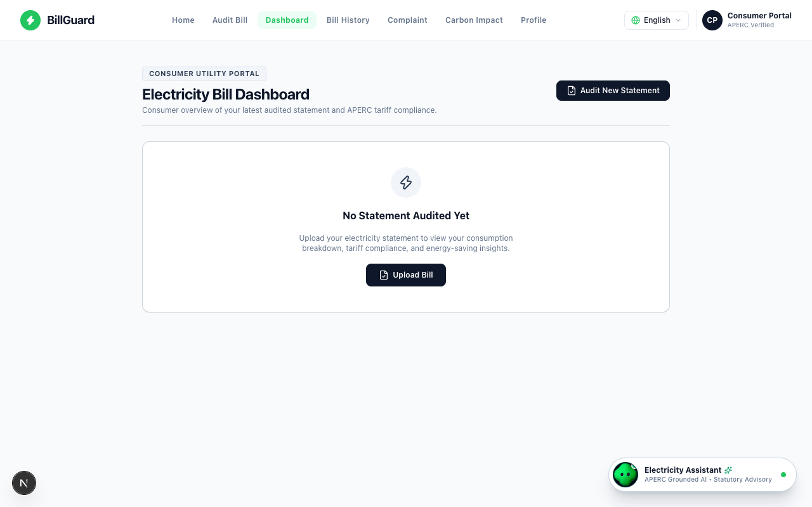
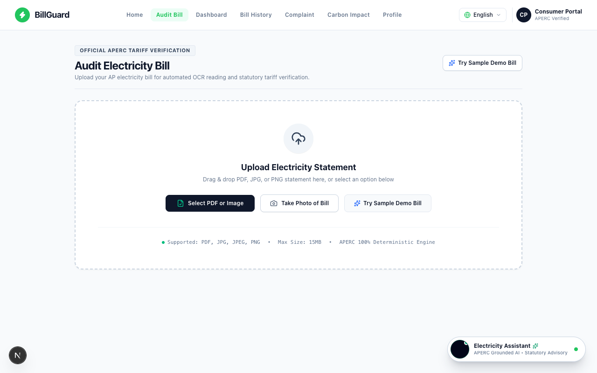
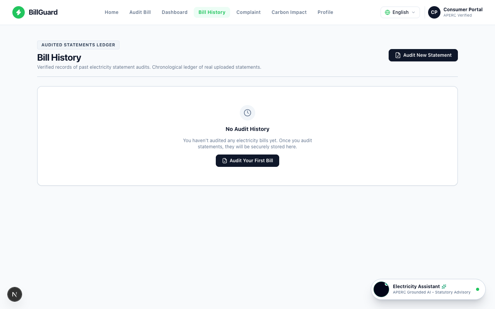
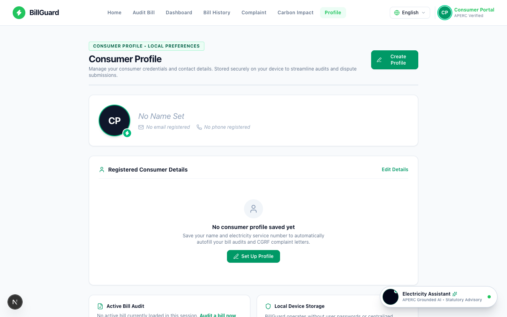
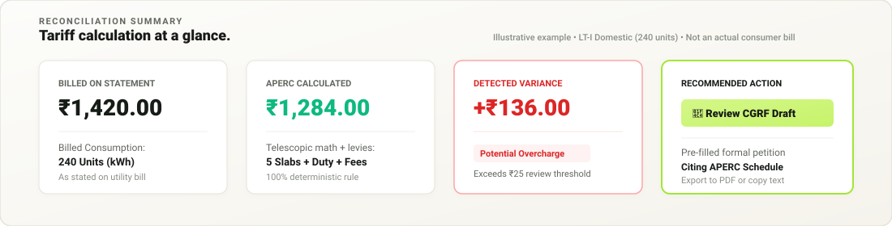
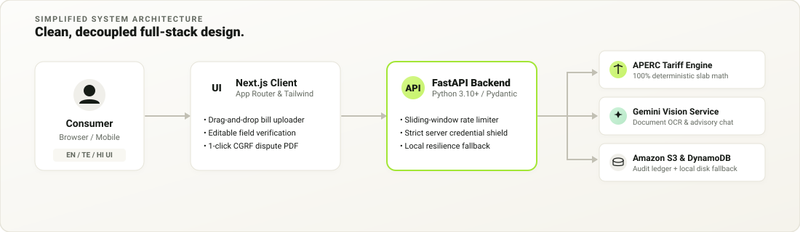

<div align="center">

<!-- Hero Banner (Warm Ivory / Electric Lime Fintech Identity) -->


<br />
<br />

# BillGuard
### *Know what your electricity bill should be.*

<p align="center">
  <b>AI-assisted electricity bill auditing that helps consumers in Andhra Pradesh compare billed charges against tariff calculations and understand potential discrepancies.</b>
</p>

<p align="center">
  <a href="#-from-electricity-bill-to-clarity"><b>Explore Workflow</b></a> •
  <a href="#-quick-start"><b>Run Locally</b></a> •
  <a href="#-technology-stack"><b>Tech Stack</b></a> •
  <a href="docs/TARIFF_METHODOLOGY.md"><b>Tariff Methodology</b></a> •
  <a href="docs/ARCHITECTURE.md"><b>Architecture Docs</b></a>
</p>

<br />

</div>

---

## ⚡ Electricity bills should be understandable.

Every month, millions of households in Andhra Pradesh receive utility statements with complex telescopic slabs, customer charges, fixed connection fees, and electricity duties. When charges spike, consumers cannot easily distinguish between increased seasonal consumption and billing calculation anomalies.

BillGuard eliminates this confusion by providing structured extraction, transparent mathematical audits, and consumer dispute tools.

<div align="center">
  
</div>

<br />

> [!NOTE]
> **Responsible Verification:** BillGuard audits compare bill figures with published APERC tariff schedules. Variances serve as signals for review and do not guarantee an error or a refund. Final billing outcomes depend on billing cycle length, sanctioned load, and physical meter inspection records.

---

## 🎬 Live Verification in Motion

Watch the seamless transition from raw electricity statement to a verified audit report and pre-filled dispute letter:

<div align="center">
  
</div>

### Genuine Product Interface

Captured directly from the running BillGuard application (`http://localhost:3000`):

<div align="center">

| Consumer Dashboard &amp; Analytics | Bill Upload &amp; Field Verification |
| :---: | :---: |
|  |  |
| *Real-time metrics, audit ledger, and savings tracking* | *Multimodal document OCR with human-in-the-loop review* |

| Audit History Ledger (DynamoDB) | Consumer Profile &amp; DISCOM Settings |
| :---: | :---: |
|  |  |
| *Chronological ledger with persistent cloud sync* | *Configurable account settings and DISCOM circle office* |

</div>

<p align="center">
  <a href="docs/SCREENSHOTS.md"><b>View Full Resolution Screenshot Specifications →</b></a>
</p>

---

## 🔄 From electricity bill to clarity.

BillGuard enforces a disciplined five-stage verification pipeline that keeps the consumer in full control of their data.

<div align="center">
  
</div>

<br />

1. **Upload:** The consumer selects an electricity bill (PDF document or camera photo).
2. **Extract:** Server-side AI vision processes the document and identifies service numbers, meter reads, units, and billed amounts.
3. **Review:** The consumer checks and fine-tunes extracted values in an interactive review sheet before any calculation occurs.
4. **Audit:** A 100% deterministic mathematical engine calculates expected charges using gazetted APERC retail tariff schedules.
5. **Act:** The consumer reviews the variance breakdown and can generate a formal CGRF dispute draft if an overcharge is identified.

> [!TIP]
> **Deterministic vs. Generative:** AI is used solely for document OCR extraction and natural-language explanations. All tariff arithmetic, slab allocations, and variance calculations are executed by **deterministic Python code** with zero model hallucination.

---

## 🌟 Main Capabilities

A compact suite of tools designed for consumer advocacy and billing transparency:

<div align="center">

| Feature | User Benefit |
| :--- | :--- |
| **📄 AI-Assisted Bill Extraction** | Automatically parses messy utility bills and camera photos into clean structured fields. |
| **📐 Deterministic Tariff Calculations** | Accurately calculates charges across all 6 APERC domestic telescopic slabs and statutory duties. |
| **✏️ Human-in-the-Loop Review** | Enables consumers to inspect and correct extracted OCR numbers before running audits. |
| **🔍 Expected-vs-Actual Variance Analysis** | Detects calculation anomalies and flags variances exceeding the ₹25 review threshold. |
| **🌐 Multilingual Guidance** | Delivers plain-language billing explanations localized in English, Telugu (**తెలుగు**), and Hindi (**हिंदी**). |
| **⚖️ CGRF Dispute Draft Preparation** | Automatically formats formal complaint petitions citing gazetted tariff order clauses ready to submit. |

</div>

---

## 🧮 Tariff Reconciliation at a Glance

BillGuard reconciles electricity statements against official retail supply tariff schedules. Below is an illustrative demonstration of how charges are audited:

<div align="center">
  
</div>

<br />

```
Illustrative Audit Summary (LT-I Domestic • 240 Units Consumed)
─────────────────────────────────────────────────────────────────────────────
• Slab 1 (0 – 30 u @ ₹1.90)       : ₹  57.00
• Slab 2 (31 – 75 u @ ₹3.00)      : ₹ 135.00
• Slab 3 (76 – 125 u @ ₹4.50)     : ₹ 225.00
• Slab 4 (126 – 225 u @ ₹6.00)    : ₹ 600.00
• Slab 5 (226 – 240 u @ ₹8.75)    : ₹ 131.25
• Fixed Connection & Customer Fees: ₹  85.00
• Electricity Duty & Fuel Surcharge: ₹  50.40
─────────────────────────────────────────────────────────────────────────────
APERC Expected Subtotal           : ₹1,283.65 (Rounded to ₹1,284.00)
Actual Billed Amount              : ₹1,420.00
Identified Variance               : +₹136.00 (Exceeds ₹25 review threshold)
Recommended Action                : Generate CGRF Formal Dispute Letter
```

*For complete mathematical formulas, customer charge tiers, and statutory rounding rules, see [`docs/TARIFF_METHODOLOGY.md`](docs/TARIFF_METHODOLOGY.md).*

---

## 🏛️ Simplified Architecture

BillGuard utilizes a decoupled full-stack architecture that keeps third-party credentials strictly shielded on the backend:

<div align="center">
  
</div>

<br />

- **Next.js Client (React 19):** Responsive frontend providing drag-and-drop bill ingestion, editable verification fields, and client-side PDF export.
- **FastAPI Gateway (Python):** High-speed asynchronous backend handling rate limiting (60 req/min sliding window), credential management, and routing.
- **APERC Engine:** Deterministic Python tariff module modeling gazetted APERC orders for APSPDCL, APEPDCL, and APCPDCL.
- **Google Gemini API:** Server-side multimodal vision service extracting document text without training foundational models on consumer data.
- **Amazon S3 & DynamoDB:** Cloud storage for bill archives (`billguard-documents-pream-2026`) and audit records (`BillGuardAudits`) in `ap-southeast-2`, with **automatic local fallback storage** for offline development.

*For detailed data schemas, rate limiting, and AWS IAM policies, see [`docs/ARCHITECTURE.md`](docs/ARCHITECTURE.md).*

---

## 🛠️ Technology Stack

| Layer | Technologies | Purpose |
| :--- | :--- | :--- |
| **Frontend** | **Next.js 16** (App Router), **React 19**, **Tailwind CSS 4** | Clean, responsive consumer interface |
| **State & Tools** | **Zustand**, **Lucide React**, **jsPDF**, **i18next** | Client state, icons, PDF generation, trilingual translation |
| **Backend** | **FastAPI 0.115**, **Python 3.10+**, **Pydantic 2.8** | Asynchronous API gateway, schemas, and rate limiter |
| **AI Vision** | **Google Gemini 2.5 Flash** | Multimodal OCR field extraction and advisory chat |
| **Cloud & Storage** | **Amazon S3**, **Amazon DynamoDB**, **Boto3** | Bill document vault, audit ledger, and local JSON fallback |
| **Quality** | **75 Automated Unit & Integration Tests** | 42 frontend tests + 33 backend tests passing (100%) |

---

## 🚀 Quick Start

Run BillGuard locally on macOS, Linux, or Windows (WSL2).

### Prerequisites
- **Node.js:** `v18.17+` (v20+ recommended)
- **Python:** `3.10+`
- **Gemini API Key:** (Optional for local testing; required for live AI OCR via [Google AI Studio](https://aistudio.google.com/))

### 1. Clone & Configure
```bash
git clone https://github.com/prempareesh/BillGuard.git
cd BillGuard
cp .env.example .env.local
```
*(Add your `GEMINI_API_KEY` to `.env.local`. Cloud storage automatically uses local fallback if AWS credentials are not configured.)*

### 2. Start the Backend
```bash
cd backend
python3 -m venv .venv
source .venv/bin/activate       # On Windows: .venv\Scripts\activate
pip install -r requirements.txt
python -m uvicorn backend.app.main:app --host 127.0.0.1 --port 8001 --reload
```
- Health Check: [`http://127.0.0.1:8001/health`](http://127.0.0.1:8001/health)
- Interactive API Docs: [`http://127.0.0.1:8001/docs`](http://127.0.0.1:8001/docs)

### 3. Start the Frontend
In a new terminal window:
```bash
npm install
npm run dev
```
Open [`http://localhost:3000`](http://localhost:3000) in your browser.

### 4. Run Verified Test Suites
```bash
# Frontend test suite (42 tests: slabs, persistence, multilingual PDFs, profile)
npm test

# Backend test suite (33 tests: deterministic math & API endpoints)
PYTHONPATH=. backend/.venv/bin/python -m unittest backend/tests/test_tariff_engine.py
PYTHONPATH=. backend/.venv/bin/python -m unittest backend/tests/test_api_endpoints.py
```

---

## 🔒 Security & Responsible Use

- **Credential Isolation:** Google Gemini API keys and AWS credentials reside strictly on the server side. No private tokens are exposed to client-side bundles.
- **Document Privacy:** Electricity bills contain consumer account details. Production deployments must enforce private S3 access policies and encrypted persistence. In local development mode, documents remain safely inside git-ignored local storage (`backend/storage/`).
- **Independent Verification:** BillGuard is an educational and consumer advocacy tool. Variances should be verified with the local DISCOM section officer before submitting formal dispute petitions to the Consumer Grievance Redressal Forum.

---

## 🤝 Contribution & License

### Contributing
Contributions to tariff schedules, localization improvements, and new state regulatory models are welcome. Please open an issue or submit a pull request against the `main` branch.

### License Status
This project currently does not have an open-source license applied. All rights are reserved by the repository owner (`prempareesh`). Please contact the maintainer if you wish to license this codebase for public or commercial distribution.

### Regulatory Notice
**BillGuard** is an independent auditing project. It is not affiliated with, endorsed by, or operated by the **Andhra Pradesh Electricity Regulatory Commission (APERC)**, **APSPDCL**, **APEPDCL**, or **APCPDCL**. All tariff schedules are sourced from publicly gazetted regulatory orders.

---

<div align="center">

**BillGuard** — *Know what your electricity bill should be.*  
Built with pride for Andhra Pradesh consumers.

[](https://github.com/prempareesh/BillGuard)

</div>
