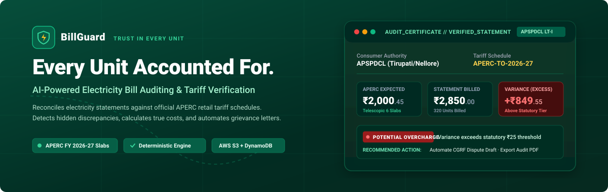
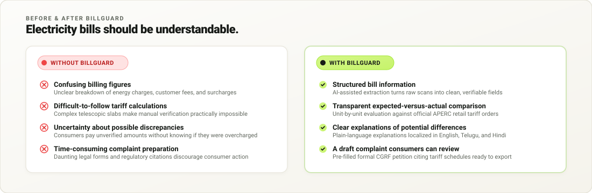
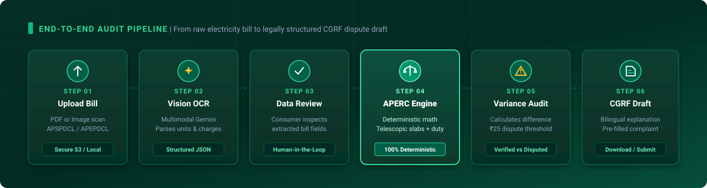
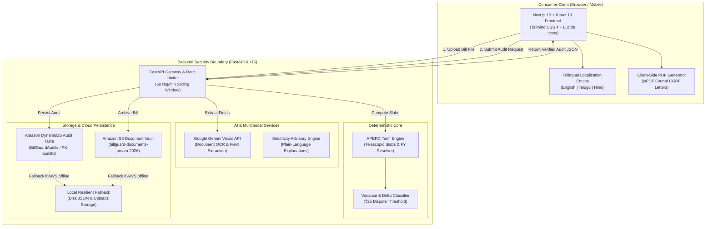

<div align="center">

<!-- Hero Banner Vector Asset -->


<br />
<br />

# Every Unit Accounted For.
### AI-Powered Electricity Bill Auditing &amp; Statutory Tariff Verification for Andhra Pradesh

[](https://nextjs.org/)
[](https://react.dev/)
[](https://fastapi.tiangolo.com/)
[](https://python.org/)
[](https://aws.amazon.com/s3/)
[](https://aws.amazon.com/dynamodb/)
[](https://aperc.gov.in/)
[-10B981?style=for-the-badge)](tests/)

<br />

<p align="center">
  <b>BillGuard</b> bridges the information asymmetry between power distribution companies (DISCOMs) and consumers in Andhra Pradesh.<br />
  By pairing multimodal document vision with a <b>100% deterministic mathematical verification engine</b> based on gazetted <b>APERC Retail Supply Tariff Orders</b>, BillGuard inspects domestic and commercial statements, reconciles telescopic slab billing line-by-line, identifies calculation anomalies, and equips citizens with legally structured dispute drafts.
</p>

<p align="center">
  <a href="#-quick-navigation"><b>Explore Architecture</b></a> •
  <a href="#-the-core-product-story"><b>Product Story</b></a> •
  <a href="#-how-billguard-works"><b>Verification Pipeline</b></a> •
  <a href="#-verified-feature-showcase"><b>Features</b></a> •
  <a href="#-step-by-step-tariff-audit-walkthrough"><b>Tariff Walkthrough</b></a> •
  <a href="#-local-development--installation"><b>Run Locally</b></a>
</p>

</div>

---

## 🧭 Quick Navigation

- [The Core Product Story](#-the-core-product-story)
- [How BillGuard Works (Pipeline)](#-how-billguard-works)
- [Verified Feature Showcase](#-verified-feature-showcase)
- [Step-by-Step Tariff Audit Walkthrough](#-step-by-step-tariff-audit-walkthrough)
- [Technical Architecture](#-technical-architecture)
- [Technology Stack](#-technology-stack)
- [Project Structure](#-project-structure)
- [Local Development & Installation](#-local-development--installation)
- [Security & Responsible Use](#-security--responsible-use)
- [Visual Showcase & Screenshots](#-visual-showcase--screenshots)
- [Roadmap & Contributing](#-roadmap--contributing)
- [License & Disclaimers](#-license--disclaimers)

---

## ⚡ The Core Product Story

### The Consumer Dilemma

Every month, millions of residential consumers across Andhra Pradesh served by **APSPDCL**, **APEPDCL**, and **APCPDCL** receive electricity statements. For most households, deciphering these bills is nearly impossible:

1. **Opaque Telescopic Slabs:** Residential energy is billed across **6 distinct consumption tiers** (from ₹1.90/unit to ₹9.75/unit). Calculating fractional consumption across slab boundaries by hand requires complex tabular arithmetic.
2. **Additional Statutory Line Items:** Bills include variable customer charges, fixed connection fees, electricity duty (₹0.06/unit under the AP Electricity Duty Act), and Fuel & Power Purchase Cost Adjustments (FPPCA).
3. **Information Asymmetry:** When a bill surges unexpectedly, consumers cannot easily distinguish between increased seasonal consumption, slab progression, meter reading recording errors, or billing calculation anomalies.
4. **Daunting Dispute Process:** Filing a complaint with the **Consumer Grievance Redressal Forum (CGRF)** or Electricity Ombudsman requires formal citations of specific APERC tariff order clauses, account numbers, and itemized variance breakdowns.

```
+--------------------------------------------------------------------------------------------------+
|                                    BEFORE BILLGUARD vs. WITH BILLGUARD                           |
+--------------------------------------------------------------------------------------------------+
| WITHOUT BILLGUARD                               | WITH BILLGUARD                                 |
| ----------------------------------------------- | ---------------------------------------------- |
| • Opaque, confusing paper statement             | • Clear, itemized, unit-by-unit visual audit   |
| • 6 telescopic slab rates calculated in secret  | • 100% deterministic APERC tariff math engine  |
| • Uncertainty over meter reads and surcharges   | • Automated meter delta & duty reconciliation  |
| • Confusing technical jargon                    | • Trilingual plain-language guidance (EN/TE/HI)|
| • Powerless consumer with no recourse           | • 1-click statutory CGRF dispute draft ready   |
+--------------------------------------------------------------------------------------------------+
```

<div align="center">
  
</div>

> [!NOTE]
> **Responsible Verification Disclosure:** BillGuard audits are mathematical comparisons between bill line items and published APERC tariff schedules. Audit variances highlight potential discrepancies for consumer inspection and do not automatically prove DISCOM misconduct. Final billing outcomes depend on billing cycle duration, meter accuracy, sanctioned load, and official meter inspection records.

---

## 🔄 How BillGuard Works

BillGuard follows a disciplined, 6-stage verification pipeline with a **human-in-the-loop review** stage to guarantee that deterministic calculations are never executed on unverified OCR assumptions.

<div align="center">
  
</div>

### The 6 Stages of Verification


1. **Bill Ingestion:** The consumer uploads a PDF statement or high-resolution mobile camera scan of an APSPDCL, APEPDCL, or APCPDCL bill. The original document is archived securely to an Amazon S3 bucket (or local encrypted storage in development mode).
2. **Vision Extraction:** Server-side Google Gemini multimodal extraction extracts key billing parameters: Consumer Service Number, Billing Month/Cycle, Meter Reads (Previous & Current), Units Consumed, Billed Energy Charges, Customer Charges, Fixed Charges, and Total Billed Amount.
3. **Consumer Verification (Human-in-the-Loop):** The extracted numbers are presented to the consumer in an interactive editable review sheet. The consumer can inspect, confirm, or amend any OCR field before running the audit.
4. **Deterministic APERC Calculation:** The tariff engine resolves the applicable gazetted tariff schedule (e.g., `APERC-TO-2026-27` or `APERC-TO-2024-25`), computes domestic telescopic slab costs, adds statutory customer charges, fixed charges, AP electricity duty (₹0.06/unit), and FPPCA.
5. **Variance Classification:** The computed total is reconciled against the actual bill:
   - **`Verified` (Green):** Calculated amount matches actual bill within statutory rounding (or $|variance| \le ₹25.00$).
   - **`Potential Overcharge` (Red):** Actual bill exceeds verified APERC math by $> ₹25.00$.
   - **`Review Recommended` (Orange):** Undercharge $> ₹25.00$ or meter read delta mismatch ($|\Delta meter - units| > 2$).
6. **Action & Dispute Resolution:** For any flagged discrepancy, BillGuard generates an itemized audit certificate and drafts a formal, pre-filled grievance letter addressed to the respective DISCOM Circle Forum under **APERC Consumer Grievance Redressal Forum Regulations**.

---

## 🌟 Verified Feature Showcase

Every feature listed below is verified in the active codebase with passing automated test suites.

| Feature | Consumer Benefit | Implementation Status | Core Technologies |
| :--- | :--- | :---: | :--- |
| **Deterministic APERC Tariff Engine** | Calculates exact energy charges across 6 telescopic domestic slabs, electricity duty, and customer charges according to official APERC gazette orders. | `IMPLEMENTED` | Python 3.10+, FastAPI, Pydantic |
| **Multimodal Vision OCR Extraction** | Ingests PDF bills and camera scans, extracting service number, units, meter readings, and billed line items without requiring manual data entry. | `IMPLEMENTED` | Google Gemini API (Server-Side), Boto3 S3 |
| **Human-in-the-Loop Field Editor** | Allows consumers to inspect and fine-tune extracted OCR numbers prior to calculation, preventing false positives from poor photo quality. | `IMPLEMENTED` | React 19, TypeScript 5, Tailwind CSS 4 |
| **Meter Delta Verification** | Compares $(Current\ Read - Previous\ Read)$ against billed units to detect transcription and meter rollover errors. | `IMPLEMENTED` | `tariff_engine.py`, Next.js UI |
| **Trilingual Support (EN / TE / HI)** | Full UI and explanation localization in English, Telugu (**తెలుగు**), and Hindi (**हिंदी**), enabling accessible utility advocacy across Andhra Pradesh. | `IMPLEMENTED` | `i18next`, `react-i18next`, Custom Locales |
| **Statutory CGRF Dispute Draft Generator** | Pre-fills formal grievance petitions addressed to DISCOM Circle Consumer Grievance Redressal Forums with exact APERC schedule citations. | `IMPLEMENTED` | `ai.py`, `ComplaintSection.tsx`, `jsPDF` |
| **Amazon DynamoDB Audit Ledger** | Persists audit history records, grievance drafts, and variance metrics in a high-throughput single table (`BillGuardAudits`) keyed by `auditId`. | `IMPLEMENTED` | Amazon DynamoDB, Boto3, `dynamoStore.ts` |
| **Amazon S3 Document Vault** | Archives original uploaded bill PDFs and images in S3 (`billguard-documents-pream-2026`) with signed access URLs. | `IMPLEMENTED` | Amazon S3, Boto3, `s3_service.py` |
| **Resilient Local Fallback Engine** | Ensures seamless local development and offline resilience by providing disk-backed JSON persistence when AWS credentials are not configured. | `IMPLEMENTED` | `dynamo_service.py`, `s3_service.py` |
| **Interactive Electricity Assistant** | Conversational assistant providing plain-language explanations of complex utility charges, fixed tariffs, and energy-saving recommendations. | `IMPLEMENTED` | Server-side Gemini, `AIAssistantChat.tsx` |

<details>
<summary><b>View Roadmap &amp; Planned Future Capabilities</b></summary>

<br />

The following capabilities are planned for upcoming releases:
- [ ] **Smart Meter (AMI) Telemetry:** Direct integration with smart meter interval consumption feeds.
- [ ] **Multi-State Tariff Expansion:** Deterministic tariff engines for Telangana (**TSERC**), Karnataka (**KERC**), and Tamil Nadu (**TNERC**).
- [ ] **Direct DISCOM CGRF Submission:** Direct API gateway integration to submit grievance petitions into APSPDCL / APEPDCL online portals.

</details>

---

## 🧮 Step-by-Step Tariff Audit Walkthrough

To understand the mathematical rigor of BillGuard's engine, consider this illustrative verification walkthrough for a domestic residential connection (**LT-I Domestic Category**) under the **APERC Retail Supply Tariff Order FY 2026–27**.

> [!TIP]
> **Walkthrough Parameters:** 
> - **Category:** LT-I Domestic (Telescopic)
> - **Billed Consumption:** **240 Units (kWh)**
> - **Actual Bill Amount:** **₹1,420.00**

### 1. Telescopic Energy Charges Calculation

APERC mandates a progressive telescopic tariff structure where units consumed are split across brackets:

```
Units 0 - 30    :  30 units  ×  ₹1.90/unit  =  ₹  57.00
Units 31 - 75   :  45 units  ×  ₹3.00/unit  =  ₹ 135.00
Units 76 - 125  :  50 units  ×  ₹4.50/unit  =  ₹ 225.00
Units 126 - 225 : 100 units  ×  ₹6.00/unit  =  ₹ 600.00
Units 226 - 240 :  15 units  ×  ₹8.75/unit  =  ₹ 131.25
------------------------------------------------------------
Total Energy Charges (240 units)            =  ₹1,148.25
```

### 2. Statutory Levies and Fixed Charges

```
+ Fixed Connection Charges (Domestic Baseline)       =  ₹  30.00
+ Customer Charges (Bracket: 226–400 units)          =  ₹  55.00
+ Electricity Duty (240 units × ₹0.06 / unit)        =  ₹  14.40
+ FPPCA Fuel Surcharge (240 units × ₹0.15 / unit)    =  ₹  36.00
------------------------------------------------------------
Calculated Statutory Total                          =  ₹1,283.65
Statutory Rounding under Supply Code (Nearest Rupee) =  ₹1,284.00
```

### 3. Variance & Audit Classification

$$\text{Variance} = \text{Actual Billed Amount} - \text{Expected Verified Total}$$
$$\text{Variance} = ₹1,420.00 - ₹1,284.00 = \mathbf{+₹136.00}$$

```
+--------------------------------------------------------------------------------------------------+
| AUDIT ENGINE DECISION MATRIX                                                                     |
+--------------------------------------------------------------------------------------------------+
| Metric               | Value              | Regulatory Rule / Status                             |
+----------------------+--------------------+------------------------------------------------------+
| Actual Billed Amount | ₹1,420.00          | Line item on consumer electricity statement          |
| APERC Expected Total | ₹1,284.00          | 100% deterministic mathematical evaluation           |
| Variance (Δ)         | +₹136.00           | Consumer billed higher than tariff schedule          |
| Dispute Threshold    | ₹25.00             | Exceeds statutory materiality threshold              |
| Classification       | POTENTIAL OVERCHARGE | Marked as red badge in BillGuard dashboard         |
| Recommended Action   | Generate Dispute   | CGRF grievance letter drafted with APERC citations   |
+--------------------------------------------------------------------------------------------------+
```

---

## 🏛️ Technical Architecture

BillGuard utilizes a modern decoupled full-stack architecture designed for enterprise reliability, high-speed calculation, and strict data security.



### Security & Credential Boundary

- **No Secrets in Frontend:** All third-party communication with the Google Gemini API and AWS services (`boto3`) executes exclusively inside the FastAPI backend. No API keys or AWS credentials exist in client bundles.
- **Role-Based IAM:** Designed for AWS deployment using IAM execution roles (**AWS App Runner** or **Amazon ECS**) with least-privilege permissions (`s3:PutObject`, `s3:GetObject`, `dynamodb:PutItem`, `dynamodb:GetItem`, `dynamodb:DeleteItem`).
- **Resilient Fallback Mode:** In development environments without active AWS credentials, BillGuard switches automatically to local filesystem storage (`backend/storage/`), ensuring complete offline feature parity.

---

## 🛠️ Technology Stack

| Layer | Technology | Version | Purpose in BillGuard |
| :--- | :--- | :---: | :--- |
| **Frontend Framework** | **Next.js** (App Router) | `16.4.0` | Server-rendered React application framework |
| **UI Library** | **React** | `19.3.0` | Component-based reactive user interface |
| **Styling System** | **Tailwind CSS** | `^4.0` | Utility-first styling with emerald/forest green theme |
| **State Management** | **Zustand** | `^5.0` | Lightweight, scalable client audit state management |
| **Icons & Visuals** | **Lucide React** | `^1.53` | Clean, accessible utility and verification iconography |
| **Document Export** | **jsPDF** | `^4.2` | Client-side generation of formal CGRF dispute PDFs |
| **Localization** | **i18next** | `^26.4` | Trilingual translation engine (English, Telugu, Hindi) |
| **Backend Framework** | **FastAPI** | `0.115` | High-performance asynchronous Python REST API |
| **Data Validation** | **Pydantic** | `^2.8` | Strict schema validation for billing and audit payloads |
| **AI Vision & Chat** | **Google Gemini** | `2.5 Flash` | Multimodal document parsing and conversational assistant |
| **Cloud Storage** | **Amazon S3** | `ap-southeast-2` | Document vault for bill PDFs and verification images |
| **Audit Persistence** | **Amazon DynamoDB** | `ap-southeast-2` | NoSQL ledger storing audit records and dispute cases |
| **AWS SDK** | **Boto3** | `^1.35` | Official AWS SDK for Python backend integration |
| **Language Runtime** | **Python** | `3.10+` | Core execution environment for tariff engine |
| **Language Runtime** | **Node.js** | `18+` | Next.js frontend execution and test runtime |

---

## 📂 Project Structure

```
BillGuard/
├── assets/
│   └── readme/                          # High-resolution vector diagrams for documentation
│       ├── billguard-hero-banner.svg     # Brand mark and verification certificate banner
│       ├── billguard-workflow.svg        # 6-stage end-to-end audit pipeline illustration
│       └── billguard-comparison.svg      # Before vs With BillGuard comparative matrix
├── docs/
│   ├── SCREENSHOTS.md                   # Step-by-step visual capture and recording guide
│   └── DEPLOYMENT.md                    # AWS App Runner & Amplify deployment manual
├── src/                                 # Next.js 15 Frontend
│   ├── app/
│   │   ├── audit/                       # Interactive bill upload and audit review route
│   │   ├── dashboard/                   # Consumer analytics, savings metrics, and charts
│   │   ├── history/                     # Chronological audit ledger with DynamoDB sync
│   │   ├── complaint/                   # CGRF dispute generator and letter review
│   │   ├── profile/                     # Consumer account settings and DISCOM selection
│   │   └── page.tsx                     # Landing page with interactive demo preview
│   ├── components/
│   │   ├── audit/                       # EditableBillFields, AIAssistantChat, ComplaintSection
│   │   ├── layout/                      # Navbar, Footer, Language Selector
│   │   └── ui/                          # Button, Modal, Card, Input primitive components
│   ├── lib/
│   │   ├── tariffEngine.ts              # Client-side mirror of APERC tariff calculation logic
│   │   └── dynamoStore.ts               # Unified API client for DynamoDB and audit records
│   └── locales/                         # Multilingual translations (en.json, te.json, hi.json)
├── backend/                             # FastAPI Python Backend
│   ├── app/
│   │   ├── main.py                      # Application entry point, CORS, and rate limiting
│   │   ├── config.py                    # Environment settings with fallback detection
│   │   ├── tariff_engine.py             # 100% deterministic APERC math engine (LT-I Slabs)
│   │   ├── gemini_service.py            # Multimodal vision OCR parser and prompt engineering
│   │   ├── s3_service.py                # Amazon S3 document upload and signed URL service
│   │   ├── dynamo_service.py            # Amazon DynamoDB single-table CRUD operations
│   │   └── routes/                      # Modular endpoints (upload, ocr, tariff, ai, records)
│   ├── storage/                         # Resilient local fallback storage (offline mode)
│   │   ├── dynamodb_records.json        # Disk-backed audit ledger fallback
│   │   └── uploads/                     # Local bill document cache
│   └── tests/                           # Python backend test suites
│       ├── test_api_endpoints.py        # 17 endpoint and integration tests
│       └── test_tariff_engine.py        # 16 boundary condition and slab tests
├── tests/                               # Frontend unit and invariant test suites
│   ├── tariffEngine.test.ts             # 21 boundary condition tests for APERC slabs
│   ├── workflowAndPersistence.test.ts   # 9 field correction and persistence invariant tests
│   ├── pdfMultilingual.test.ts          # 5 PDF generation tests (EN, TE, HI)
│   └── profile.test.ts                  # 7 consumer profile validation tests
├── .env.example                         # Safe environment configuration template
├── package.json                         # Node.js dependencies and test scripts
└── README.md                            # Project documentation showcase
```

---

## 💻 Local Development & Installation

Follow these steps to run BillGuard locally on macOS, Linux, or Windows (WSL2).

### Prerequisites

- **Node.js:** `v18.17` or higher (`v20+` recommended)
- **npm:** `v9+` or higher
- **Python:** `3.10` or higher
- **Google Gemini API Key:** (Optional for local testing; required for live AI OCR. Get one from [Google AI Studio](https://aistudio.google.com/))
- **AWS Credentials:** (Optional; BillGuard runs seamlessly in local fallback mode if AWS credentials are not present)

---

### Step 1: Clone the Repository

```bash
git clone https://github.com/prempareesh/BillGuard.git
cd BillGuard
```

---

### Step 2: Configure Environment Variables

Copy the provided environment template:

```bash
cp .env.example .env.local
```

Open `.env.local` and add your Gemini API key (all other settings have sensible defaults for local development):

```ini
# .env.local
ENVIRONMENT=development
GEMINI_API_KEY=your_gemini_api_key_here

# AWS Infrastructure (Uses local resilient fallback if credentials not configured)
AWS_REGION=ap-southeast-2
DYNAMODB_TABLE_NAME=BillGuardAudits
S3_BUCKET_NAME=billguard-documents-pream-2026

# Backend Endpoint
NEXT_PUBLIC_API_URL=http://127.0.0.1:8001
```

---

### Step 3: Install & Start the FastAPI Backend

Open a terminal window:

```bash
cd backend

# Create and activate Python virtual environment
python3 -m venv .venv
source .venv/bin/activate       # On Windows: .venv\Scripts\activate

# Install dependencies
pip install -r requirements.txt

# Start FastAPI development server
python -m uvicorn backend.app.main:app --host 127.0.0.1 --port 8001 --reload
```

- **Backend Health Check:** [`http://127.0.0.1:8001/health`](http://127.0.0.1:8001/health)
- **AWS Status Endpoint:** [`http://127.0.0.1:8001/api/aws/status`](http://127.0.0.1:8001/api/aws/status)
- **Interactive Swagger Docs:** [`http://127.0.0.1:8001/docs`](http://127.0.0.1:8001/docs)

---

### Step 4: Install & Start the Next.js Frontend

Open a second terminal window in the root directory:

```bash
# Install frontend dependencies
npm install

# Start Next.js development server
npm run dev
```

Open [`http://localhost:3000`](http://localhost:3000) in your browser.

---

### Step 5: Execute Test Suites

BillGuard includes **75 passing automated tests** across both frontend and backend to guarantee tariff calculation invariants and persistence reliability.

#### Run Frontend Tests (42 Tests)
```bash
npm test
```
*Executes boundary tests for all 6 APERC slabs, multilingual PDF generation, workflow state persistence, and profile validation.*

#### Run Backend Tariff Engine Tests (16 Tests)
```bash
PYTHONPATH=. backend/.venv/bin/python -m unittest backend/tests/test_tariff_engine.py
```
*Verifies 100% deterministic mathematical calculations, customer charges, and statutory rounding invariants.*

#### Run Backend API Endpoint Tests (17 Tests)
```bash
PYTHONPATH=. backend/.venv/bin/python -m unittest backend/tests/test_api_endpoints.py
```
*Verifies rate limiting, health checks, OCR mock handling, audit CRUD, and complaint generation.*

---

## 🔒 Security & Responsible Use

### Data Privacy & Bill Documents
- **Sensitive Information Handling:** Electricity bills contain consumer names, addresses, and account numbers. In production, documents uploaded to Amazon S3 must use private access controls and server-side encryption (SSE-S3 or SSE-KMS).
- **Transient AI Processing:** Extracted bill parameters are passed to Google Gemini strictly for OCR parsing and explanation generation. Sensitive consumer identifiers are never used to train foundational AI models.
- **Local Fallback Isolation:** In local development mode, documents and records are stored inside `backend/storage/` which is excluded from Git via `.gitignore`.

### Consumer Grievance Disclaimer
- **Not Legal Counsel:** BillGuard is an independent auditing and consumer advocacy platform. The generated variance calculations and CGRF dispute drafts are educational tools designed to help consumers understand their utility charges.
- **Formal Verification Required:** Consumers must verify their physical meter readings, account numbers, and billing cycle days with their local DISCOM section officer before submitting formal dispute petitions.

---

## 📸 Visual Showcase & Screenshots

Capture and view the full visual interface across desktop and mobile viewports. For instructions on capturing these screens from your local instance, refer to [`docs/SCREENSHOTS.md`](docs/SCREENSHOTS.md).

```
+--------------------------------------------------------------------------------------------------+
| APPLICATION SCREENSHOT DIRECTORY (See docs/SCREENSHOTS.md for capture specifications)           |
+--------------------------------------------------------------------------------------------------+
| 01. Consumer Dashboard        | Metrics cards, recent audit ledger, and consumption trends        |
| 02. Bill Upload & OCR Review  | File drag-and-drop with interactive human-in-the-loop editor     |
| 03. Tariff Audit Breakdown    | Telescopic slab table, fixed charges, and variance classification |
| 04. CGRF Dispute Generator    | Pre-filled legal letter citing APERC order clauses in EN/TE/HI    |
| 05. Bill History Ledger       | Complete audit history with DynamoDB persistence and delete flow  |
+--------------------------------------------------------------------------------------------------+
```

| Screen | Viewport | Target Asset Path | Description |
| :--- | :---: | :--- | :--- |
| **01. Consumer Dashboard** | Desktop | `assets/readme/screenshots/01-dashboard-overview.png` | Overview of audited bills, identified overcharges, and monthly consumption trends. |
| **02. Bill Upload & OCR** | Desktop | `assets/readme/screenshots/02-bill-upload-ocr.png` | Interactive upload screen showing structured field extraction and human verification. |
| **03. Tariff Audit Breakdown** | Desktop | `assets/readme/screenshots/03-tariff-audit-breakdown.png` | Unit-by-unit telescopic breakdown showing expected vs. billed charges. |
| **04. CGRF Dispute Draft** | Desktop | `assets/readme/screenshots/04-cgrf-dispute-draft.png` | Formal dispute letter formatted for the Consumer Grievance Redressal Forum. |
| **05. Bill History & Ledger** | Desktop | `assets/readme/screenshots/05-bill-history-ledger.png` | Chronological ledger of verified audits with persistent DynamoDB sync. |

> [!NOTE]
> **Live Demo Availability:** A public cloud deployment on AWS App Runner & AWS Amplify is currently being finalized. In the meantime, you can run the complete project locally in under 3 minutes following the [Local Development Guide](#-local-development--installation).

---

## 🗺️ Roadmap & Contributing

### Planned Milestones

- [x] **Phase 1 (Completed):** 100% deterministic APERC tariff engine for APSPDCL, APEPDCL, and APCPDCL.
- [x] **Phase 2 (Completed):** Multimodal Gemini OCR extraction and human-in-the-loop field review sheet.
- [x] **Phase 3 (Completed):** Amazon DynamoDB single-table audit persistence and S3 document vault with local fallback.
- [x] **Phase 4 (Completed):** Trilingual support in English, Telugu (**తెలుగు**), and Hindi (**हिंदी**).
- [ ] **Phase 5 (In Progress):** Public AWS deployment via AWS Amplify (Frontend) and AWS App Runner (Backend).
- [ ] **Phase 6 (Planned):** Smart Meter interval consumption telemetry support.
- [ ] **Phase 7 (Planned):** Multi-state regulatory engine expansion (TSERC for Telangana, KERC for Karnataka).

---

### Contributing to BillGuard

We welcome contributions from developers, energy policy researchers, and consumer advocacy specialists!

1. **Fork the Repository:** Click the `Fork` button at the top right of this repository.
2. **Create a Feature Branch:**
   ```bash
   git checkout -b feature/tariff-schedule-update
   ```
3. **Commit Your Changes:**
   ```bash
   git commit -m "feat: add support for commercial seasonal load tariff schedule"
   ```
4. **Run the Full Test Suite:**
   ```bash
   npm test
   PYTHONPATH=. backend/.venv/bin/python -m unittest discover backend/tests
   ```
5. **Open a Pull Request:** Submit your PR against the `main` branch with a clear description of your improvements.

---

## 📜 License & Disclaimers

### License Status
This project currently does not have an open-source license applied. All rights are reserved by the repository owner (`prempareesh`). If you plan to use or distribute this code in public or commercial applications, please contact the maintainer or choose an appropriate open-source license (such as the **MIT License** or **Apache 2.0**).

### Regulatory Notice
**BillGuard** is an independent consumer utility auditing platform. It is not affiliated with, endorsed by, or operated by the **Andhra Pradesh Electricity Regulatory Commission (APERC)**, **APSPDCL**, **APEPDCL**, or **APCPDCL**. All tariff schedules and regulatory references are sourced from publicly gazetted tariff orders issued by APERC.

---

<div align="center">

**Built with pride for Andhra Pradesh consumers.**<br />
*Every Unit Accounted For.*

[](https://github.com/prempareesh/BillGuard)

</div>
